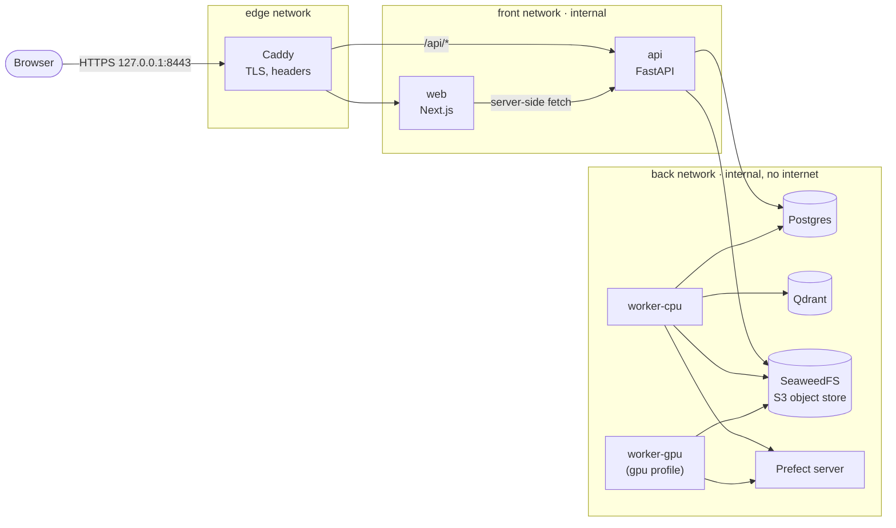

# Kagebox

Adapt comics, manga and manhwa into hand-drawn-style animated episodes — faithful to the original character designs, with cast voices and an original score.

Kagebox only processes works you own, have licensed, or that are in the public domain. Rendering is locked server-side until a project has a rights record approved by an admin other than the person who submitted it.

- Engineering brief: [`CLAUDE.md`](CLAUDE.md)
- Designs, logo and tokens: [`docs/design/`](docs/design/README.md)
- Third-party licenses: [`LICENSES.md`](LICENSES.md)

**Status:** Phase 0 (foundation) is done: stack, schemas, auth, rights records, provider interface, pipeline skeleton, web shell, CI. Phase 1 (motion-comic MVP) is next.

## Architecture



Only Caddy publishes a port, bound to `127.0.0.1`. Postgres, Qdrant, the object store, Prefect and (later) ComfyUI live on internal networks with no route to the internet. Only the one-shot `models-fetch` job has egress; `worker-cpu` has none (its weights are local and no stage calls a hosted API yet).

| Path | What it is |
|---|---|
| `pipeline/common/schemas/` | Strict Pydantic v2 schemas for every inter-stage artifact |
| `pipeline/common/uploads.py` | Upload validation: content sniffing, image re-encoding, safe archive reading |
| `pipeline/providers/` | Model provider interface, Together backend, model/weights policy |
| `orchestration/` | Prefect flows (chapter pipeline with rights gate) and one-shot jobs |
| `apps/api/kagebox_api/` | FastAPI: auth, CSRF, projects, rights records, signed media |
| `apps/web/` | Next.js + Tailwind UI built from `docs/design/` |
| `configs/` | Pinned models, thresholds, `trust_remote_code` allowlist (empty) |
| `deploy/` | Compose stack, Dockerfiles, Caddyfile, secrets (gitignored) |

## Setup

Requirements: Docker Desktop (or Docker Engine with Compose v2) and `make`. **Nothing else is installed on the host**; Python, Node and every scanner run in pinned containers.

```bash
mkdir -p data/imports   # server-side imports, one subdirectory per project (gitignored), mounted read-only
make up-cloud
```

This creates `.env` from `.env.example`, generates random secrets in `deploy/secrets/` (never overwritten, gitignored), builds the images and waits until every service is healthy. Then:

```bash
make admin
```

```bash
make user
```

Rights approval needs two people: a member submits a rights record, an admin approves it. Open https://localhost:8443 and sign in. Caddy uses its own local CA; accept the certificate warning or trust the root at `caddy-data:/data/caddy/pki/authorities/local/root.crt`.

The `understand` stage runs a local model and needs no API key. A Together AI key (`deploy/secrets/together_api_key.txt`) is only for later hosted stages (for example the director); no stage uses it yet and it is not mounted into the workers.

Chapter sources up to 200 MB are uploaded over HTTP (`POST /api/chapters/{id}/upload`). Larger ones are imported server-side. Imports are scoped per project: put the file in `data/imports/<project_id>/` (gitignored; create the directory; regular files only, symlinks are ignored, a hard link is fine) and call `POST /api/chapters/{id}/import` with `{"name": "<file name>", "page_start": 1, "page_end": N}`. The API and the worker look only in the directory of the chapter's own project, so a source staged for one project can neither be imported nor probed through another (whose rights record does not cover it). `data/imports` is mounted read-only at `/imports` into `api` and `worker-cpu`; the API only matches the bare name against a listing of the project's directory.

Both return `202 {"job_id": ...}`. Follow the run with `GET /api/jobs/{job_id}` (`submitted` → `running` → `completed` / `failed` / `cancelled`) and the chapter with `GET /api/chapters/{id}` (`pending` → `ingesting` → `ready` / `failed`, with a user-safe `error`). A run heartbeats the chapter after every page; an `ingesting` chapter with no heartbeat for 10 minutes is reported as failed (`ingest was interrupted`) and accepts a new source, and a run longer than 3 hours is ended (`ingest timed out`). Request bodies are capped at 1 MB (Caddy and the API) except the multipart upload routes (chapter source, rights evidence).

### Make targets

| Target | What it does |
|---|---|
| `up-cloud` | Start the stack, no GPU needed (default). Later generation stages use Together AI; `understand` runs locally on the CPU in every profile |
| `up-gpu` | Start with `worker-gpu` (needs the NVIDIA Container Toolkit) |
| `down` / `logs` / `ps` | Stop (volumes kept), follow logs, list services |
| `admin` / `user` | Create an account (password prompted, never echoed or logged) |
| `test` | Python and web unit tests |
| `lint` | ruff, ruff format, mypy --strict, bandit |
| `scan` | `lint` + pip-audit, pnpm audit, hadolint, Trivy (repo), gitleaks; fails on high/critical |
| `bakeoff-understand` | Vision-model bake-off through `deploy/scripts/bakeoff.sh`: runs in the existing `kagebox/worker:dev` image with the working tree's `pipeline/` and `orchestration/` bind-mounted, no rebuild |
| `scan-images` | Trivy on the built images (exported tarballs; the Docker socket is never mounted) |

**Image rebuilds are unavailable while the Debian apt signature error persists** (`apt-get update` fails with an invalid signature, so `make worker-image` and `make up-cloud` cannot rebuild, and a failed rebuild fills the Docker VM disk with build cache). Do not rebuild; start the stack with `KAGEBOX_PROFILE=cloud docker compose -f deploy/compose.yaml --env-file .env up -d --no-build --wait` and run the bake-off with the script above.

### Understand stage (scene descriptions)

`understand` describes every panel with a local vision model (Qwen3-VL 2B, bf16, CPU, loaded from the read-only `models` volume; the workers run with `HF_HUB_OFFLINE=1` and `TRANSFORMERS_OFFLINE=1`, so nothing is fetched at runtime and no panel leaves the machine). Text regions are flattened before the model sees a panel, and OCR text is never sent. Measured on an idle Mac with 4 CPU threads: p50 91 s and p95 128 s per panel (187 panels), so the 238-panel sample chapter took about 5 h for its 187 uncached panels (the rest were cached). Under load it is slower. It is an overnight batch: run a trial first (`limit_panels`, at most 50), read the projected time, then confirm the full run. Runs are cached and resumable.

- **Memory:** `worker-cpu` has `mem_limit: 8g` (peak RSS about 5.5 GB). Raise Docker Desktop's memory to about 11-12 GB (Settings, Resources) so the worker, Postgres and the rest of the stack fit together.
- **One heavy flow at a time:** the worker serves with a limit of 1 and concurrency 1, so ingest and understand never run together; a second heavy run waits in the queue. Re-ingesting a chapter while it is being understood is refused with 409.
- Compose changes are applied with `docker compose ... up -d --no-build --wait` (see the rebuild note above); `make up-cloud` is not needed for them.

The Phase 0 smoke test runs against the live stack: `sh tests/e2e/phase0_smoke.sh` (needs test users whose passwords are in `deploy/secrets/test_{admin,member}.password.txt`).

## Compute profiles

| Profile | Runs where | Hardware |
|---|---|---|
| `cloud` (default) | `understand` (local Qwen3-VL-2B-Instruct on CPU, no cloud), OCR, embeddings, Whisper, 2.5D render and assembly on CPU; later LLM stages on Together AI | Any Docker host. Give Docker Desktop about 11-12 GB of memory (the vision model alone peaks near 5.5 GB). Apple Silicon works (images are multi-arch). |
| `gpu` | Adds `worker-gpu` (ComfyUI API mode, TTS, music) | NVIDIA GPU with the Container Toolkit. Expected Phase 1–2 needs: 12 GB VRAM for TTS and 2.5D work, 24 GB+ for in-betweening and I2V models (to be confirmed per model). |

Docker on macOS cannot use the Apple GPU, so on a Mac the `cloud` profile is the one to use.

## Security

See `CLAUDE.md` for the full requirements. Implemented in Phase 0:

- Argon2id passwords, lockout after repeated failures, `__Host-` session cookies (HttpOnly, Secure, SameSite=Strict), CSRF token on every write, same-origin check, per-project roles (non-members get 404).
- Rights gate in the API, at the start of every flow and inside every stage task. Cloud stages also need the record to allow hosted processing.
- Uploads: size limits, type sniffed from content, images re-encoded, archive reading that refuses zip-slip, symlinks and zip bombs.
- Media served only via user-bound signed links that expire within 5 minutes; reads of evidence and consent files are audit-logged.
- Strict CSP with per-request nonces, HSTS, no framing, no referrer.
- Only `.safetensors` weights with matching checksums; `trust_remote_code` refused unless allowlisted with a review.
- Containers: images pinned by digest, non-root, read-only root filesystem, `no-new-privileges`, all capabilities dropped (Caddy keeps only `NET_BIND_SERVICE`, which its binary requires), healthchecks, resource limits.
